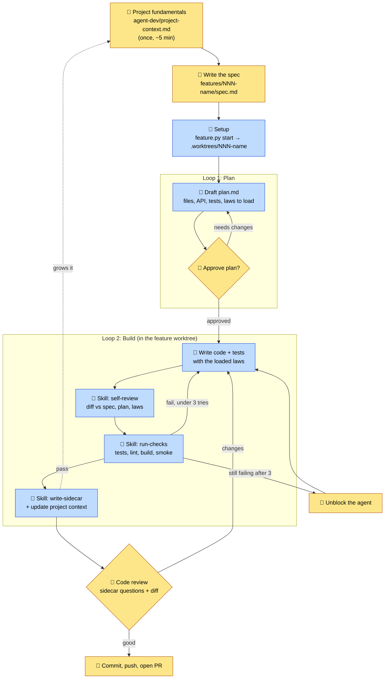
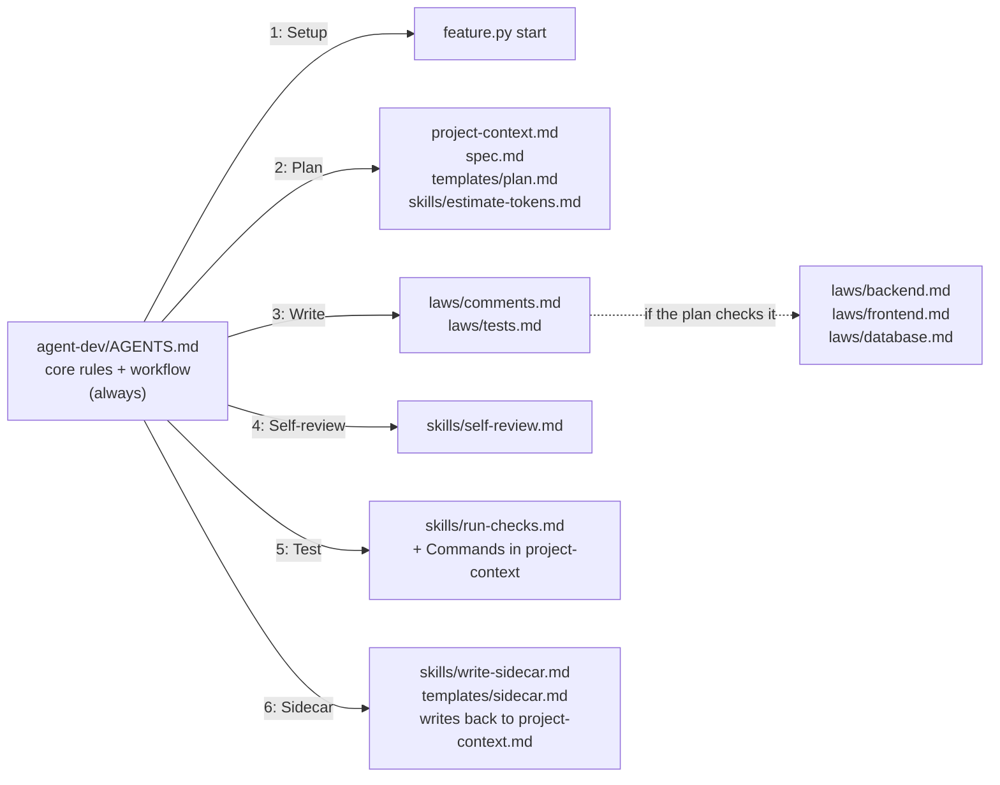

# Spec-Driven Agent Framework

A tool-agnostic way to build features with a coding agent **without losing track of how the code works.**

- **Humans own** the project fundamentals, the spec, the plan approval, and the code review.
- **The agent owns** setup (its own git worktree), writing, self-review, testing, and docs in between.

It's all markdown, so it works with any agent that can read files and run commands (Claude Code, Codex, Cursor, Copilot agent mode...). The laws are stack-neutral. Stack details live in `project-context.md`, which agents grow as the project does.

```
Project context → Spec → Setup (worktree) → Plan approval → Write with laws → Self-review → Test (skill) → Sidecar (skill) → Human code review → PR
```

---

## The workflow



🟨 = human · 🟦 = agent

| # | Step | Who | Output |
|---|---|---|---|
| 0 | Project fundamentals | 👤 team, once | Fundamentals in `project-context.md` |
| 1 | Spec | 👤 | `spec.md` (`feature.py new`) |
| 2 | Setup | 🤖 | `.worktrees/NNN-name` on `feat/NNN-name` (`feature.py start`) |
| 3 | Plan approval (Loop 1) | 🤖 drafts, 👤 approves | `plan.md` with token estimate, marked APPROVED |
| 4 | Write with laws | 🤖 | code + tests |
| 5 | Self-review | 🤖 (skill) | fixes + notes for the sidecar |
| 6 | Test | 🤖 (skill) | check results; up to 3 fix attempts |
| 7 | Sidecar docs | 🤖 (skill) | `sidecar.md` + updates to `project-context.md` |
| 8 | Code review → PR | 👤 | merged feature |

### The human checkpoints
| Checkpoint | What you're really checking | Time |
|---|---|---|
| **Spec** | Do we know what we want? Is "Done when" testable? | ~5–10 min |
| **Plan approval** | Is the design right: files, API shapes, test cases, assumptions? Is the token estimate worth it? Cheapest place to catch a bad idea. | ~3 min |
| **Code review** | Can I explain this code? The sidecar questions prove it. | ~10 min |

---

## Structure

```
your-project/
├── AGENTS.md              pointer → agent-dev/AGENTS.md (Codex, Cursor, Copilot)
├── CLAUDE.md              pointer → agent-dev/AGENTS.md (Claude Code)
└── agent-dev/
    ├── README.md          this file
    ├── AGENTS.md          the workflow + core rules (always loaded)
    ├── project-context.md fundamentals (human) + everything learned so far (agents)
    ├── laws/              stack-neutral coding rules, loaded only when relevant
    │   ├── comments.md    always when writing code
    │   ├── tests.md       always when writing code
    │   ├── backend.md     if the plan touches server code
    │   ├── frontend.md    if the plan touches client code
    │   └── database.md    if the plan touches schema / seed data
    ├── skills/            step-by-step procedures
    │   ├── estimate-tokens.md
    │   ├── self-review.md
    │   ├── run-checks.md
    │   └── write-sidecar.md
    ├── templates/         spec.md, plan.md, sidecar.md
    ├── feature.py         new (spec stub) · start (worktree) · done (cleanup), any OS
    └── features/
        └── 003-shift-signup/
            ├── spec.md    human
            ├── plan.md    agent drafts, human approves
            └── sidecar.md agent writes, reviewer reads
```

### What loads when

The agent only loads what the current step needs, so its context stays focused.



- The plan's **"Laws to load"** checklist decides which optional laws apply, so you see it at plan approval.
- **Laws say what; project context says how.** A law like "tests use an isolated database" stays the same on any stack. The *how* (the test fixture, the ORM pattern, the test command) lives in `project-context.md` → Commands + Stack conventions, which agents fill in the first time each piece is set up. Switching stacks = new fundamentals; the laws don't change.

---

## Integrating Into Dev Repo

### Once
1. Copy `agent-dev/`, `AGENTS.md`, and `CLAUDE.md` into the project repo root. From the root:
   ```bash
   # Mac
   curl -L https://github.com/CarterRudolph2005/agent-framework/tarball | tar -xz --strip-components=1 "*/agent-dev" "*/AGENTS.md" "*/CLAUDE.md"
   # Linux / Git Bash on Windows (GNU tar needs --wildcards)
   curl -L https://github.com/CarterRudolph2005/agent-framework/tarball | tar -xz --wildcards --strip-components=1 "*/agent-dev" "*/AGENTS.md" "*/CLAUDE.md"
   ```
   Naming the three paths keeps the framework's own README from overwriting the project's.
2. Fill in the four **Fundamentals** in `agent-dev/project-context.md` together (~5 min). Agents fill in the rest as features land.

### Per feature
1. **Claim the next ID** in the team chat, then create the spec:
   ```bash
   python agent-dev/feature.py new 003 shift-signup     # python3 on Mac/Linux if needed
   ```
2. **Fill in** `agent-dev/features/003-shift-signup/spec.md`.
3. **Open your agent at the repo root** and say:
   ```
   Follow agent-dev/AGENTS.md for agent-dev/features/003-shift-signup
   ```
4. **Approve the plan → wait for "Ready for review."**
5. **Code review:** in `.worktrees/003-shift-signup/`, read the sidecar and review `git diff main...HEAD`.
6. **Commit, push, open the PR** from the worktree. 
7. After merge: `python agent-dev/feature.py done 003-shift-signup`

**Note:** Worktrees live inside the repo in `.worktrees/` (ignored locally through `.git/info/exclude`, so no tracked file changes), which keeps them reachable by any agent tool opened at the root. Each one needs its own dependency install (npm install, venv...) to run the app.

### For Small changes (fast path)
If the change is simple, skip the spec/plan/sidecar and just ask the agent to do it. Laws, self-review, and checks will still run.

---

## Writing `project-context.md`

**Fundamentals: humans write these once (~5 min)**

| Section | What goes in it |
|---|---|
| **Problem** | The organization, what they do, the problem. 3–5 sentences. |
| **Users** | Each user type and what they need. |
| **Demo goals** | What must work, in priority order. Agents use this to judge tradeoffs. |
| **Tech stack** | One line per layer. |

**Grows with the project: agents add these at the sidecar step**

| Section | Added when a feature... |
|---|---|
| **Architecture** | adds a layer or external service |
| **Folder layout** | adds a folder or changes where code lives |
| **Data model** | adds or changes a table |
| **API** | adds or changes an endpoint |
| **Commands** | first uses a run / test / lint / build / smoke command (`run-checks` reads these) |
| **Conventions** | adds an env var, naming rule, or format |
| **Stack conventions** | sets up a pattern others should copy (test fixtures, model pattern, helpers) |
| **Decisions log** | makes a choice the next feature should know about |


## Writing a spec

| Section | What goes in it |
|---|---|
| **Goal** | Why it exists and who it's for. One or two sentences. |
| **Operation flow** | Step by step: what triggers it, what happens, what the result is. A user clicking through, a request moving through the system, or a job running. |
| **API contract** | Only if the API changes. Per endpoint: method + path, request, success, errors. Free-form; fixed after plan approval. |
| **Changes / Dev** | Anything the builder should know: schema changes, UI notes, areas involved, constraints, what *not* to change. |
| **Done when** | Numbered, testable checks. Each becomes a test. |

The agent picks the simplest option and lists it under "Risks / assumptions" in the plan **if any part of the spec is not defined**.
